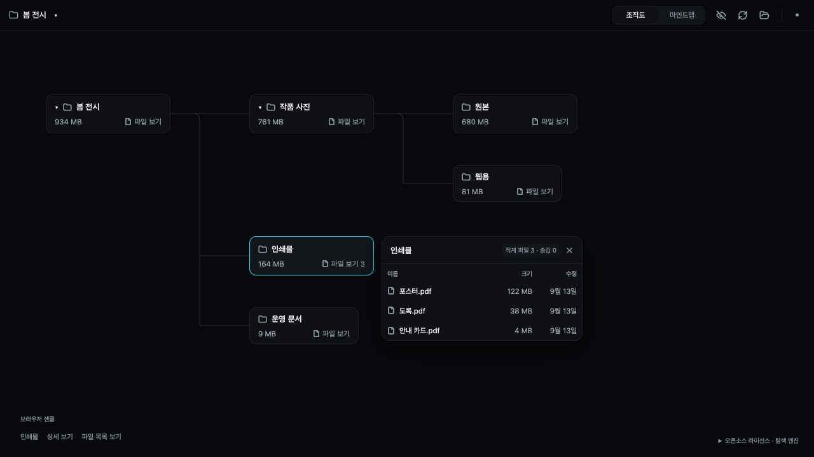
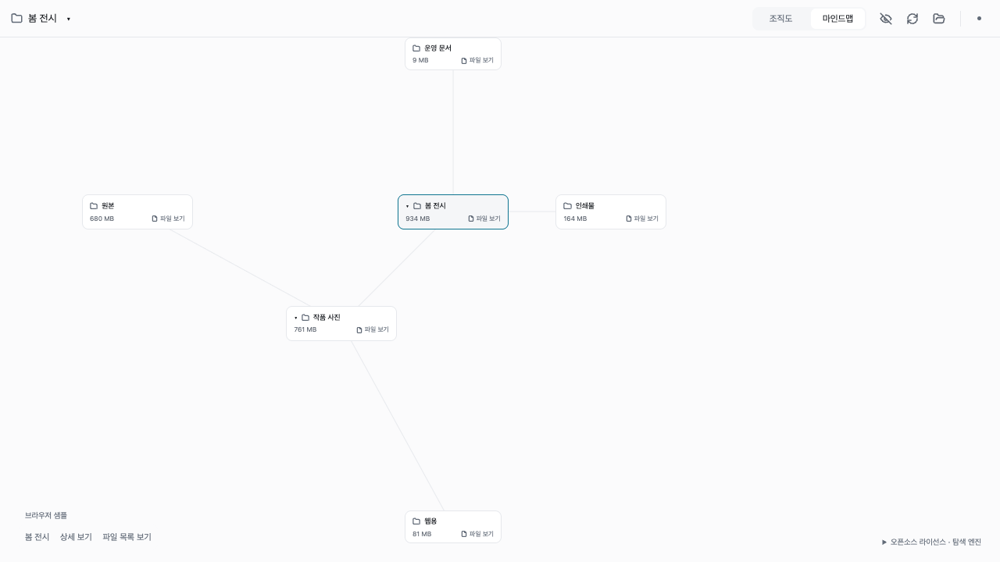

# Directory UI Viewer

Mac에서 폴더 구조를 **조직도와 마인드맵**으로 펼쳐 보는 읽기 전용 앱입니다. 처음 받은 프로젝트에서 어떤 자료가 어디에 있고 어느 폴더가 공간을 많이 쓰는지 한 화면에서 살펴볼 수 있습니다.



<details>
<summary>같은 폴더를 마인드맵으로 보기</summary>



</details>

## 사용해 보기

첫 배포 대상은 **Apple Silicon Mac**입니다. 공개 설치판을 준비하고 있어 지금은 아래 명령으로 소스에서 실행할 수 있습니다. 설치판이 공개되면 [GitHub Releases](https://github.com/GubikoDev/directory-ui-viewer/releases)에서 받을 수 있습니다.

1. **폴더 열기**로 살펴볼 폴더를 선택하세요. 폴더가 펼쳐지는 동안에도 다른 가지를 탐색할 수 있습니다.
2. **폴더 이름**을 누르면 가지가 접히거나 펼쳐집니다. **파일 보기**를 누르면 그 폴더 바로 아래의 파일과 크기, 수정일이 표시됩니다.
3. **조직도 / 마인드맵**으로 보기를 전환하세요. 트랙패드에서 두 손가락으로 이동하고 핀치로 확대하거나 축소할 수 있습니다.
4. **용량 숫자**를 누르면 논리 크기와 디스크 사용량을 확인할 수 있습니다. 숫자 뒤의 `+`는 현재까지 확인한 부분 용량입니다.

선택한 폴더의 정보를 Mac 안에서 읽습니다. 숨김 항목은 상단 눈 모양 버튼으로 표시할 수 있습니다. 심볼릭 링크의 대상과 다른 마운트는 따라가지 않으며, 폴더를 이동한 뒤에는 다시 선택해야 할 수 있습니다. 읽기 권한이나 자원 한도에 따라 파일 목록과 용량 집계가 일부만 표시될 수 있습니다.

## 소스에서 실행

Apple Silicon Mac에서 Node.js 24.21.0, npm 11.19.0, Rust와 [Tauri의 macOS 개발 도구](https://v2.tauri.app/start/prerequisites/)를 준비하세요. 현재 앱 구현은 [codex/internal-core](https://github.com/GubikoDev/directory-ui-viewer/tree/codex/internal-core)에 있습니다.

```bash
git clone --branch codex/internal-core https://github.com/GubikoDev/directory-ui-viewer.git
cd directory-ui-viewer
npm ci
npm run tauri dev
```

브라우저에서 예제 데이터로 화면만 살펴보려면 `npm run dev`를 실행하세요. 배포용 빌드와 검증 방법은 [macOS 배포 문서](https://github.com/GubikoDev/directory-ui-viewer/blob/codex/internal-core/docs/macos-release.md)에 있습니다.

## 피드백과 라이선스

탐색이 멈추거나 파일이 예상과 다르게 표시되면 앱 버전, macOS 버전, 재현 순서를 알려주세요. 실제 경로와 개인 파일명은 예시 이름으로 바꿔 주세요. [문제 제보](https://github.com/GubikoDev/directory-ui-viewer/issues/new?template=bug_report.yml)

Directory UI Viewer는 **MIT License**로 배포합니다. 포함된 오픈소스 패키지에는 각 패키지의 라이선스가 적용됩니다. [프로젝트 라이선스](LICENSE) · [macOS 의존성 및 원문 고지](https://github.com/GubikoDev/directory-ui-viewer/blob/codex/internal-core/licenses/MACOS-NOTICES.txt)
